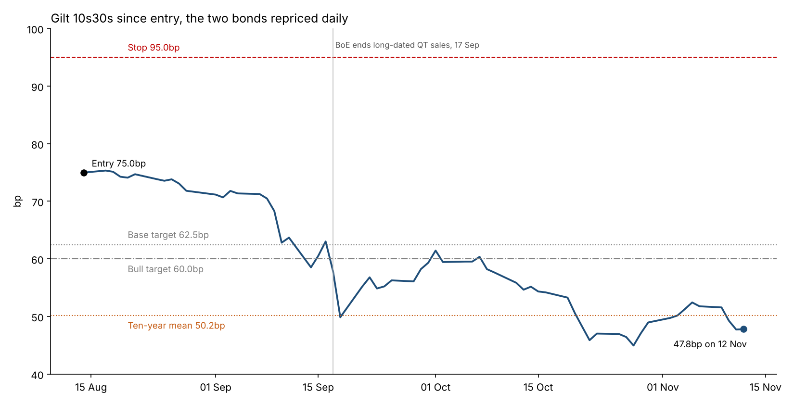
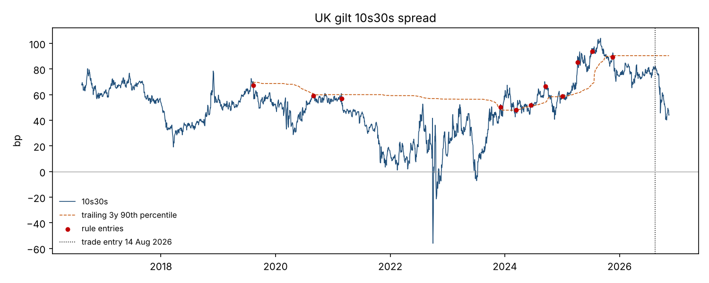

# UK gilt 10s30s flattener: pricing, carry and risk in Python

A rates relative-value trade built from first principles: long the 2056 gilt, short a DV01-matched
amount of the 2035. The code prices both gilts from their cash flows, sizes the position, measures
carry two ways and finds where they disagree, then tests the entry against the spread's own history.

Levels are from 14 August 2026 (settlement 17 August), Bloomberg close. Spread history is the Bank of England's
fitted nominal curve, which is free, so anyone can reproduce every number here.

## The findings

- **The pricer reproduces Bloomberg exactly.** For both gilts, clean and dirty price, accrued interest,
  modified duration, DV01 and convexity all match Bloomberg YAS to the precision the terminal displays
  (largest difference 0.000006), using the UK Debt Management Office conventions, including the
  ex-dividend rule.
- **The trade is a pure curve view.** Sizing at 1.8738 units of the 2035 per unit of the 2056 makes it
  DV01-neutral, so a parallel shift in yields nets to roughly zero. The position is also net long
  convexity, by 2.59 to 1.
- **The steepness is gilt-specific and real.** 31.5bp of the 75.0bp spread is not in the SONIA swap
  curve, and 74.2bp of it is real yield rather than inflation.
- **Carry is 38% worse than the spreadsheet showed.** The usual shortcut (coupon less repo plus roll)
  gives -1.74bp of spread a quarter. Repricing the cash flows gives **-2.40bp**, or -GBP3,238 against
  -GBP2,351 per GBP1m of the 2056. Most of the gap is pull to par. The 2035 trades below par, so it
  accretes towards 100 even if yields don't move, and a short position gives that up. The bridge below
  explains every pound of the difference.
- **On the corrected carry, one quarter has a negative expected value.** It falls from +0.14bp to
  -0.52bp. The near target does not pay for the risk, so the trade only works over two to three
  quarters of reversion towards the ten-year mean.
- **So far the trade has worked.** Repricing the two bonds daily off the Bank of England curve, the spread
  narrowed 27.2bp from entry on 14 August to 12 November, from 75.0bp to 47.8bp. At the August sizing that is
  about GBP645,000, or 1.3 times the risk budget, and the worst point was only 0.35bp against the position.
  Two thirds of the gain came from the short 2035 cheapening as markets priced Bank of England hikes, not from
  the 30-year rallying. (On the Bank's generic 10-year and 30-year points the curve flattened 37bp.)
- **History does not support it as a systematic trade.** Over ten years the spread fails an ADF test for
  mean reversion (p = 0.24, or 0.43 over the last two years), with an 86-day half-life. A mechanical version of
  the entry made 11 trades, 7 of them winners, but averaged +0.8bp before carry and -1.6bp after it. What made
  this trade work was the discretionary case (the UK long end outperforming the US and Germany, and the
  forward already pricing flattening), not a statistical tendency to revert.
- **The entry context holds up on independent data.** The Bank of England curve puts the spread at the 93.2nd
  percentile of the decade, against 93.1% on Bloomberg. One base rate is weaker than the original note claimed.
  From above 70bp, a three-month widening beyond 20bp happened in 0.6% of 332 windows (worst +21.8bp), not
  never. The stop sits at the edge of history, not outside it.
- **DV01-neutral really does remove the level.** In a PCA of daily curve moves, level explains 0.5% of the
  variance in 10s30s changes, slope 69.4% and curvature most of the rest (98.7% for all three). The position
  is a slope trade with some curvature exposure.





## Carry bridge

GBP per quarter, per GBP1m of the 2056 held against the DV01-matched 2035.

| step | GBP |
|---|---|
| Spreadsheet carry and roll | -2,351 |
| Coupon accrual on actual/actual, not /365 | -82 |
| Pull to par on discount bonds | -736 |
| Repo saved after the 2035 coupon is paid | -114 |
| Roll-down repriced exactly, not yield x DV01 | +44 |
| **Exact carry and roll** | **-3,238** |

## The position

| | Short leg | Long leg |
|---|---|---|
| Bond | UKT 4 3/4 22-Oct-2035 | UKT 5 3/8 31-Jan-2056 |
| Yield | 5.0199% | 5.7698% |
| DV01 per 100 | 7.199 | 13.490 |
| Convexity | 0.636 | 3.089 |
| Size at 0.5% of a GBP100m NAV at risk | GBP34.73m | GBP18.53m |

The stop is 20bp of widening, 1.50 standard deviations of a three-month move, which puts the spread
5.7bp above its ten-year high. All results are in [`results/results.md`](results/results.md).

## Method

**Pricing** (`gilt/bonds.py`)
- Each coupon is discounted at the semi-annual yield, with the first period a fraction r/s of a full
  period (r is days to the next coupon, s is days in the coupon period).
- Inside the 7-business-day ex-dividend window, accrued interest is negative and the next coupon goes
  to the seller.
- Risk is computed by central difference, scaled to Bloomberg's conventions (DV01 per 100 x 100,
  convexity / 100).

**Carry** (`gilt/trade.py`)
- The simple method replicates the spreadsheet: coupon accrual less repo on the dirty price, plus
  roll-down times DV01.
- The exact method funds each bond at repo, reprices it on the horizon date at its rolled-down
  yield, and credits the coupon actually paid in the window.
- The repo-forward yield of each bond gives the same carry measured in yield terms.

**Curve** (`gilt/curve.py`)
- A Nelson-Siegel-Svensson fit. Its second hump term lets the curve peak near 30 years and invert
  beyond it, which is the shape the gilt curve has. Roll-down is read off the fitted curve.

**History** (`gilt/history.py`)
- Percentiles over several windows and spread momentum.
- Next-quarter base rates conditional on the starting level, because a widening from an inverted curve
  says little about one from a steep curve.
- ADF tests and AR(1) half-life, to check the spread actually mean-reverts.
- PCA of daily curve changes, showing how much of 10s30s is a slope move.
- A rule test of the entry: top decile of the trailing three years, next-day entry, 20bp stop,
  one-quarter hold, exact carry charged. Its parameters were fixed in advance, not optimised.

## Reproduce

```
pip install -r requirements.txt
python3 run.py                # writes results/results.md (and charts when history is present)
python3 -m pytest -q tests    # pricer vs Bloomberg, spreadsheet figures, no-lookahead and stationarity tests
```

The pricing, carry and sizing need nothing beyond `data/snapshot_20260814.json`. The history layer needs the
Bank of England nominal daily curve files, which are not redistributed here. [`data/README.md`](data/README.md)
explains where to download them, or how to use a Bloomberg export instead.

## Limitations

- **Funding.** Repo is taken at 3.7308%, which equals SONIA. The repo screen probably returned its default
  rather than a firm gilt GC quote, so specialness on the 2056 is unverified.
- **Roll-down.** Roll-down is from the sovereign curve, not bond-specific forwards. On the Bank of England
  path the code re-estimates it from a fitted curve and shows the two side by side.
- **Base rates.** The base rates rest on overlapping windows from about a decade of data. That is only a
  handful of independent episodes, and none of them is a fiscal shock starting from a steep curve.
- **Two different curves.** History uses the Bank of England fitted zero-coupon curve, while the trade is priced
  off two specific bonds' yields. Levels differ by a few basis points: the spread at entry is 81.5bp on the
  Bank's curve against 75.0bp on the bonds. The two-bond mark reprices each bond off the curve and holds
  its August rich/cheap constant, so it is an estimate, not a dealer mark.
- **Carry in the rule test.** It is charged at today's -2.40bp a quarter throughout. In the low-repo years,
  actual carry was different.
- **Roll-down.** A Nelson-Siegel-Svensson fit to the Bank's spot curve gives 2.58bp of roll-down on the 10-year,
  against 1.60bp from Bloomberg's par curve. Spot and par curves have different slopes, and the fit misses by
  up to 7bp at the short end. The Bloomberg figure is kept in the carry numbers.
- **Scenario probabilities.** These are judgement. Everything else is computed.
- **Ex-dividend dates.** These skip weekends but not UK bank holidays.
